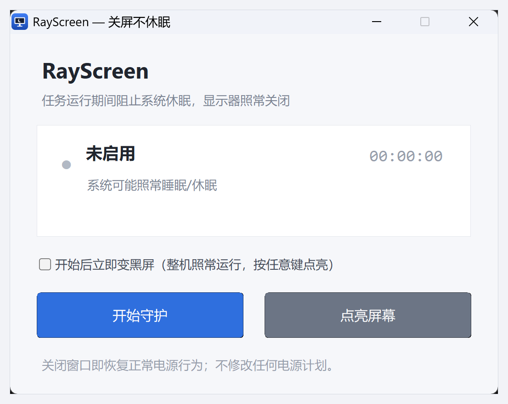

# RayScreen — 跑任务时只关屏幕，不休眠

一个 Windows 小工具：任务运行期间让**物理内屏彻底断电（背光真灭）**，同时让**整机保持全速运行**（风扇照转、不会进睡眠/连接待机）。任务结束或按任意键立即点亮，不改电源计划、不常驻后台。



## 为什么不是「让 Windows 关屏」

这台机器是 **S0 现代待机（Modern Standby）** 机型。用常规办法关屏——`SC_MONITORPOWER` 广播、电源计划里的「关闭显示器」超时、合盖——Windows 会把「屏幕熄灭」当成「用户离开」，**立刻进入连接待机**：风扇停转、任务被冻结，内核电源事件日志里是一条 `Kernel-Power 506 原因: SC_MONITORPOWER`。

试过但无效：`SetThreadExecutionState(ES_SYSTEM_REQUIRED | ES_DISPLAY_REQUIRED)`、Away Mode、`PowerRequest`（System/Execution）、把 `UNATTENDSLEEP` 设为 0、把 `PlatformAoAcOverride` 设为 0（需重启才生效）。

**有效做法**：不让 Windows 认为屏幕被关掉，而是**把桌面切到一块虚拟显示器**。物理内屏失去信号后由硬件自行断电（背光灭），Windows 则认为屏幕一直正常亮着，因此不会触发连接待机。

## 组成

| 组件 | 作用 |
| --- | --- |
| `bin\RayScreen.exe` | 图形界面（需要管理员权限） |
| `bin\RayScreen-cli.exe` | 命令行版，用来包裹长任务 |
| `vdd\` | Virtual Display Driver（[VirtualDrivers/Virtual-Display-Driver](https://github.com/VirtualDrivers/Virtual-Display-Driver)，MIT，已签名）—— 提供那块「虚拟显示器」 |

## 安装（一次 UAC）

双击 `install.cmd`，点一次「是」，剩下的自动完成：

- 复制程序到 `C:\Program Files\RayScreen`
- 安装虚拟显示驱动（若尚未安装）
- 创建两个计划任务（`RayScreen` / `RayScreenCli`，最高权限）
- 桌面 + 开始菜单快捷方式（走计划任务启动，**以后双击不再弹 UAC**）
- 在「设置 → 应用 → 已安装的应用 / 应用与功能」里登记卸载入口
- 最后跑一次自检并打印结果

`install.cmd -Startup` 可同时设置开机自启（计划任务加登录触发器）。

## 卸载（删干净、无残留）

三种入口都行：

- 开始菜单 → `RayScreen` → `卸载 RayScreen`
- Windows 设置 → 应用 → 已安装的应用 → `RayScreen 关屏不休眠` → 卸载
- 命令行：`uninstall.cmd`（在安装目录里）

它会结束进程并依次清理：桌面/开始菜单快捷方式、两个计划任务、自启动项、应用列表里的卸载项、虚拟显示设备与它带出来的显示器设备、驱动包（只删 `mttvdd` 那一个，不碰别的 `oemNN.inf`）、`C:\VirtualDisplayDriver`、`C:\ProgramData\RayScreen`、`%LOCALAPPDATA%\RayScreen`、程序目录。最后做一遍**残留检查**，全清才打印「没有残留」并以 0 退出。

`uninstall.cmd -KeepDriver` 保留虚拟显示驱动（只删程序和快捷方式）。

## 用法

1. 双击桌面「RayScreen 关屏不休眠」（不弹 UAC）
2. 勾选「开始后立即变黑屏（整机照常运行，按任意键点亮）」
3. 点「开始守护」→ 内屏立刻断电，桌面搬到虚拟屏，机器全速运行
4. 想亮屏：**按任意键**或点一下鼠标（也可以点「点亮屏幕」）
5. 任务结束点「停止守护」，或直接关窗口 —— 内屏立刻恢复

状态卡会显示「系统全速运行 · 内屏已断电（按任意键点亮）」，并计时本次守护时长。

> 注意：守护期间按键盘会点亮屏幕。如果你在同一个桌面里打字/用鼠标，屏幕会亮回来 —— 这是设计如此，不是失败。

### 命令行（包长任务）

装好后用安装目录下的 `ray.cmd`，它通过计划任务以管理员身份静默执行，**不弹 UAC**：

```bat
ray.cmd --screen-off -- cmd /c "pnpm build"
```

参数：

```
--screen-off   包裹命令期间关内屏
--screen-on    强制把内屏点亮（程序异常退出后抢救用）
--selftest     自检：电源请求、显示输出、虚拟屏是否可用
-h / --help    帮助
```

返回码 = 被包裹命令的返回码。输出实时回显；也可以直接用 `bin\RayScreen-cli.exe`（要管理员）。

## 安装虚拟显示器（只需一次）

本机已装好：`ROOT\MTTVDD\0000`（`Virtual Display Driver`，驱动包发布名 `oem42.inf`），显示器设备为 `Generic Monitor (VDD by MTT)`。

换机器时需要重装，步骤：

```bat
:: 1) 管理员命令行，把驱动包装进系统
pnputil /add-driver "vdd\VirtualDisplayDriver\MttVDD.inf" /install

:: 2) 用 tests\vddinstall.exe 创建根设备（它会自动调用 SetupAPI 建 ROOT\MTTVDD 设备并绑驱动）
tests\vddinstall.exe

:: 3) 驱动从 C:\VirtualDisplayDriver\ 读配置，把 vdd_settings.xml 放进去
mkdir C:\VirtualDisplayDriver
copy vdd\VirtualDisplayDriver\vdd_settings.xml C:\VirtualDisplayDriver\

:: 4) 设备管理器里禁用再启用一次该设备，或重启
```

`vdd_settings.xml` 里可以改虚拟屏数量（`<count>`）和分辨率列表；默认 800x600 ~ 3840x2160。虚拟屏分辨率不影响任务，选小一点反而省 GPU。

## 编译

```bat
build.cmd
```

只需要 Windows 自带的 .NET Framework 4.x 编译器（`csc.exe`），不需要 Visual Studio 或 .NET SDK。产物在 `bin\`。

`src\app.manifest` 里声明了 `requireAdministrator`（切换显示拓扑必须提权）和 `dpiAware`（高分屏不模糊）。

## 原理

1. `Power.KeepAwake()`：`SetThreadExecutionState(ES_CONTINUOUS | ES_SYSTEM_REQUIRED | ES_DISPLAY_REQUIRED)` + `PowerCreateRequest`/`PowerSetRequest`（SystemRequired + ExecutionRequired），每 15 秒重申一次。
2. `VScreen.SwitchOff()`：`QueryDisplayConfig` 保存当前活动的显示路径和模式，然后 `SetDisplayConfig` 只保留名字含 `VDD` 的那条活动路径 → 桌面搬到虚拟屏，物理内屏没有信号。
3. `WakeHook`：`WH_KEYBOARD_LL` + `WH_MOUSE_LL` 全局钩子，任意按键或鼠标左/右键按下 → 立即 `VScreen.Restore()` 按原配置恢复内屏。
4. 停止/关闭窗口/异常退出前都会 `Restore()`，另有 `--screen-on` 兜底（直接重新点亮第一条非虚拟屏）。
5. 没装 VDD 时自动回退到旧的黑窗方案（不影响「不休眠」这一基本功能）。

## 已知限制

- 切换显示拓扑需要管理员权限：所以安装时创建了最高权限的计划任务，快捷方式通过它启动，日常使用不再弹 UAC。
- 切换到虚拟屏后，屏幕上是黑的，你的窗口其实在虚拟屏上 —— 所以用「按任意键点亮」而不是「点按钮」（按钮在黑屏上看不见）。
- 虚拟屏激活期间如果有远程软件（UU 远程/向日葵）接入，看到的是虚拟屏画面，属正常。
- 电池供电时的合盖动作仍是「睡眠」，与工具无关；需要的话用 `powercfg` 单独改。

## 目录

```
RayScreen
├─ bin/                 编译产物（GUI + CLI）
├─ src/RayScreen.cs     全部源码
├─ src/app.manifest     管理员 + DPI 清单
├─ src/make_icon.py     生成 app.ico（Pillow）
├─ vdd/                 虚拟显示驱动包（MIT）
├─ tests/               探针与自动化测试源码
├─ install.cmd / .ps1   一键安装（复制、装驱动、建计划任务、建快捷方式）
├─ uninstall.cmd / .ps1 卸载（-KeepDriver 保留驱动）
├─ ray.cmd / ray.ps1    命令行入口（走计划任务，不弹 UAC）
├─ build.cmd            一键编译
└─ screenshot.png       界面截图
```
